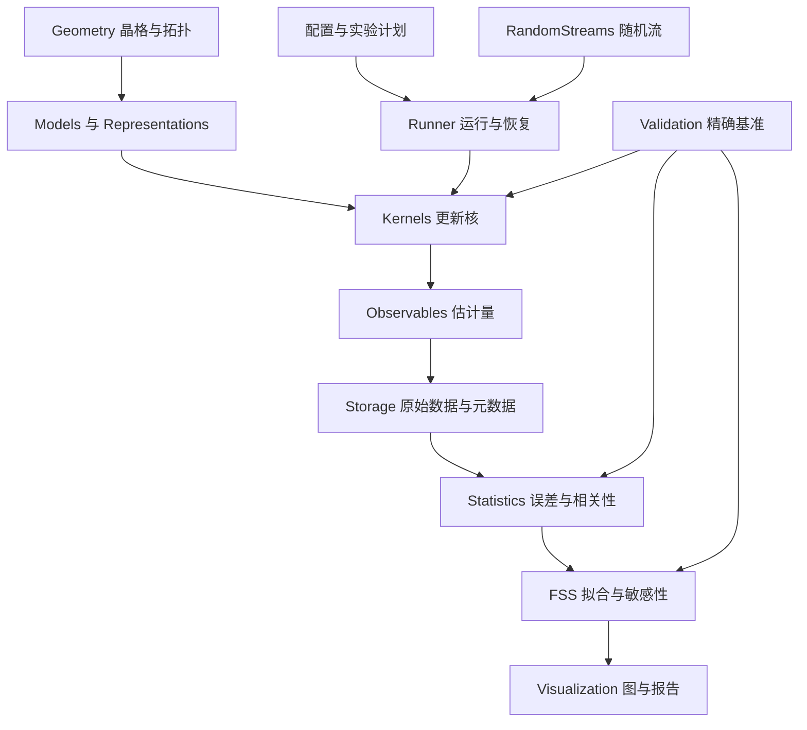

# Julia 经典统计物理 Monte Carlo 程序组与研究计划

编制日期：2026-10-30。对象：以统计物理、临界现象、计算模拟及物理与机器学习为申请方向的研究生候选人。范围：经典非量子模型；模拟核心、统计分析与正式绘图以 Julia 为主，现有 Python 程序作为独立交叉验证工具。

建议围绕一个贯穿性问题组织项目：**在给定误差目标与计算预算下，模型表示、更新算法、观测量与统计分析方法如何共同决定临界模拟的可靠性和成本？**

首个周期建议为 24 周，按每周 10–15 小时、总计约 240–360 小时规划。交付目标是一个可靠的核心程序组、三组基准实验和一个深入课题。主课题选定为 **随机团簇模型中 Sweeny 的采样效率与连通性计算成本**；Worm 与态密度方法先完成小系统验证，再根据进展选择深化。所有后述新接口、目录和排期均为拟议设计，不代表已实现功能。

# 一 现有基础与项目边界

## 已有代码可以保留什么

| 当前基础 | 已具备的内容 | 下一阶段的缺口 |
|---|---|---|
| Julia 自旋模块 | 二维周期 Ising/Potts；Metropolis、SW、Wolff；精确与不变量测试 | 几何与状态分离、workspace 复用、更完整测量和生产运行管理 |
| 渗流与随机团簇 | 简单图 bond percolation；可处理非整数 q 的 Sweeny 原型 | site percolation、Newman–Ziff、绕环；高效删边连通性 |
| Ising Worm | 固定尾端的高温图扩展系综，局域端点移动 | 端点直方图、关联函数、归一化与多时间尺度分析 |
| Entropic sampling | 通用 Wang–Landau 框架 | 具体模型的可达能级、精确 DOS 基准、1/t、固定权重生产阶段 |
| 统计分析 | 联合分块 jackknife、简单正相关窗口、自相关、固定修正指数外推 | 长尾与负相关诊断、联合 bootstrap、协方差与完整 FSS |
| 实验 | 已有 Ising 算法比较与温度扫描；Python 渗流与 Ising ML 项目 | Julia 原生端到端分析和绘图、断点恢复、统一数据规范 |

当前 `finite_size_fit` 只是固定修正指数的线性外推，不能在计划书中写成已经拥有完整的临界点与临界指数联合拟合工具。当前 Sweeny 每步重建连通信息，是正确性参考实现；Wang–Landau 是通用原型，仍需具体物理模型的系统验证。

## 明确不混淆的概念

- Sweeny、Worm、entropic sampling 是专门采样方法，不按“越新越先进”排序。Sweeny 的原始工作发表于 1983 年，早于 SW 和 Wolff。
- 自旋表示、FK 键表示和高温图表示有不同的状态空间与估计量。一个 Ising 模型可以有多种表示，表示之间不能只通过同名字段替代。
- 非整数 q 属于 random-cluster 表示；不能把整数 Potts 自旋的颜色数直接改为实数。
- 局域更新、单簇更新、全簇更新、边尝试和 worm 尝试具有不同的时钟；算法动力学不自动等于真实物理动力学。
- 论文复现、数值验证与原创研究分别标记。研究扩展是否新颖，需要对具体问题继续文献排重。

# 二 应从哪些研究与代码中学习

以下工程安排是针对本项目的设计判断；研究者的工作提供方法与参照，不表示他们为本项目背书。

| 来源 | 已核查的内容与可借鉴之处 | 在本项目中的具体落点 |
|---|---|---|
| Werner Krauth | 教学代码从枚举与短小程序建立直觉；ECMC 研究讨论非可逆链、lifting 与因子化接受规则 | 每种高效实现保留可读参考版；先精确验证，再做性能优化；远期增加 lifting/ECMC |
| Synge Todo | ALPS/looper 的组织及并行方法；Fukui–Todo 长程簇方法；Suwa–Todo 非细致平衡采样 | 模型、更新、测量、统计、存储分离；非可逆核使用全局平衡验收；长程算法作为远期方向 |
| 张潘及合作者 | VAN 论文及配套代码明确区分神经分布、采样、能量和变分目标 | 学习型 proposal 作为可选扩展；记录概率密度，采用可核验的校正或权重 |
| 邓友金及合作者 | Sweeny 的观测量相关临界加速；Worm 多时间尺度；随机团簇、渗流与 FSS | 同时研究物理相关时间和计算成本；明确图表示估计量；重视修正项与边界 |

可从 [Krauth 的 ECMC 综述](https://arxiv.org/abs/2102.07217)、[Todo 东京大学主页](https://www.s.u-tokyo.ac.jp/en/people/todo_synge/)、[张潘等 VAN 论文](https://arxiv.org/abs/1809.10606)、[邓友金等 Sweeny 论文](https://arxiv.org/abs/cond-mat/0701113)进入各条路线。

## 开源项目参考清单

| 项目 | 拟借鉴的接口或方法 | 使用边界 |
|---|---|---|
| [ALPSCore](https://github.com/ALPSCore/ALPSCore) | 参数、累积器、`update/measure/run/save/load` 职责分离 | API 与源码固定到同一版本；它是工程参考，不是 Julia 依赖要求 |
| [ALPS/looper](https://github.com/wistaria/alps-looper) | 测量、更新、并行和测试组织 | 主要是量子 Monte Carlo；本项目不纳入其量子模型；许可证是 ALPS Application License |
| [SpinMC.jl](https://github.com/fbuessen/SpinMC.jl) | 经典 O(3) 晶格、运行状态、HDF5 与 checkpoint | 其 Julia 序列化 checkpoint 不意味着跨版本可恢复 |
| [SpinMonteCarlo.jl](https://github.com/yomichi/SpinMonteCarlo.jl) | 经典 Ising/Potts/XY/Clock 和 local/SW/Wolff 的交叉验证候选 | 同包含量子部分，只参考经典部分；其 Binder 比约定需转换 |
| [stat-mech-van](https://github.com/wdphy16/stat-mech-van) | Python/PyTorch 论文配套，Ising/Hopfield/SK 的能量与神经采样记录 | 不声称为 Julia 包，也不把学习分布样本当成精确 Boltzmann 样本 |
| [BinningAnalysis.jl](https://github.com/carstenbauer/BinningAnalysis.jl) | 分块、jackknife、协方差相关工具的交叉检查 | 固定版本，对实验性接口单独验收 |
| [DrWatson.jl](https://github.com/JuliaDynamics/DrWatson.jl) | 研究项目目录、参数与结果管理 | 可在实验层采用；核心算法不绑定某个项目管理框架 |
| [Carlo.jl](https://github.com/lukas-weber/Carlo.jl) | 算法无关的调度、checkpoint 与统计后处理 | 可选 Runner 适配器；框架本身不包含 MC 算法，避免重复建设 |

阅读 README 与部分源码不等于验证整个外部项目。引用或移植时记录版本、路径、许可证与改动；算法论文和代码许可分别处理。当前核查的 ALPSCore、SpinMC.jl、SpinMonteCarlo.jl、stat-mech-van 仓库标明 MIT；正式采用前仍核对目标文件及其第三方内容。

## 已核查的桌面资源

桌面根目录记作 `~/Desktop/`，以下只列与课题有关且实际读取过的资料。

| 相对桌面的路径 | 已核查内容 | 拟安排的练习 |
|---|---|---|
| `GitHub/真·Krauth/programs_lecture_8_Krauth/enumerate_ising.py` | Gray-code 精确枚举与增量能量更新 | 生成独立能谱、配分函数和局部能差基准 |
| 同目录 `cluster_ising.py` | Wolff 簇构造，周期边界 | 对比可读版与预分配 Julia 版 |
| `GitHub/真·Krauth/SupplementaryFiles_Krauth_MC_Sampling/` | `04_factor-metropolis.py`、`06_lifted-metropolis.py` | 因子化接受率与 lifting 的小问题验证 |
| `Krauth_trial/Wolff.cpp`、`markov_pi.py` | 显式栈、临时数组；无误差分析的简单随机游走 | workspace 复用；RNG 注入与自相关诊断 |
| `邓友金_dyj/CQMC_Ising_program/` | `Ising.f90`、`markov.f90`、`measure.f90`、`statistics.f90`、`my_rng.f90` | 映射为 Julia 的运行、更新、测量与统计分层 |
| `邓友金_dyj/蠕虫算法_邓友金worms.pdf` | 首页目录、磁化率图展开与效率/自相关部分 | 先推导扩展系综，再设计 Worm 估计量 |
| `邓友金_dyj/Graphical Representations of Some Statistical Models.pdf` | 目录及前部 Ising/图表示内容 | 写自旋、FK、高温图的对应说明 |
| `计算物理/Young2015_Book_EverythingYouWantedToKnowAbout.pdf` | 目录与非线性矩组合误差讨论 | 联合 jackknife/bootstrap、相关拟合与模型选择 |

移植前有三个具体核对点：旧 Fortran 的 `Q=⟨m⁴⟩/⟨m²⟩²` 与本包 `U₄=1−Q/3` 不同；能量使用同向键计数，需要换算到哈密顿量；历史 shift-register RNG 不作为新包默认实现。静态阅读还发现 `markov.f90` 的 SW 访问标记可能没有在 `nw>1` 的每轮内部复位，尚未编译验证，应先写回归测试核查，不能因资料来源而跳过验证。

# 三 完整程序组的模块编排

采用**单仓库、一个核心 Julia package、内部独立模块、外部实验环境**。先稳定接口和依赖方向，再考虑拆包。随机流和统计工具不依赖具体模型，可以独立导入使用；独立可用不要求一开始维护多个注册包。下表是职责划分，不要求第一期为每一行开发复杂框架。



| 部件 | 应承担的责任 | 最小验收 |
|---|---|---|
| Conventions | 哈密顿量、单位、边界、总量/密度、时钟、适用条件 | 每个实验可还原所有定义 |
| RandomStreams | `AbstractRNG` 接口、链 ID 到随机流映射、状态恢复 | 固定环境复现；调度顺序改变不影响各链 |
| Geometry | 邻居表、边索引、开放/周期边界、位移信息 | 边数、邻接与手工小图一致 |
| Connectivity | union-find、参考 BFS、删边接口、绕环检测 | 任意小图增删序列与参考连通分量一致 |
| Models | Ising/Potts、site/bond、random-cluster 的参数 | 参数合法性与解析极限 |
| Representations | 自旋、占据键、worm 端点/图状态 | 权重与表示映射有文档 |
| Kernels | 局域、簇、Sweeny、Worm、DOS 更新 | 平衡分布、不变量和适用范围测试 |
| Observables | 基础量、矩、关联函数、结构因子、几何量 | 可与精确值或独立算法比较 |
| Accumulators | 在线均值/矩、连续分块、联合块数据 | 与原始轨迹离线计算一致 |
| Statistics | ACF、相关时间、ESS、联合 jackknife/bootstrap | 合成相关序列与覆盖率检查 |
| FSS | 交点、斜率、联合拟合、修正项、重加权 | 合成数据参数恢复及敏感性分析 |
| Runner | 初始化、热化、生产、测量计划、独立链、停止与恢复 | 连续跑与恢复跑一致 |
| Storage | schema、轨迹、元数据、checkpoint、原子写入 | 数据可独立读取；损坏和重复记录被发现 |
| Visualization | 离线重画、诊断图、结果图、可选交互 | 不重新采样即可再生成主图 |
| Validation | 枚举、转移矩阵、性质测试、外部对照 | 确定性正确性测试与随机长测试分层 |
| Benchmarks 与 Docs | 编译/稳态计时、分配、ESS/s、文档和引用 | 比较可追溯，读者能运行并解释 |

建议目录逐步演化为以下结构；不一次性移动所有现有文件，先通过兼容接口迁移。

```text
ClassicalMonteCarlo/
  src/
    ClassicalMonteCarlo.jl
    RandomStreams/  Geometry/  Connectivity/
    Models/        Representations/  Kernels/
    Observables/   Accumulators/      Statistics/
    FSS/           Runner/            Storage/
  ext/                    # 可选 HDF5、绘图等扩展
  test/                   # 单元、精确分布、恢复、回归
  validation/             # 独立枚举器与解析参考
  benchmarks/             # 性能与误差成本
  experiments/
    Project.toml          # 分析与绘图依赖
    Manifest.toml         # 锁定已发表实验环境
    configs/ scripts/ reference-data/
  docs/                   # 约定、方法、研究报告
  Project.toml
```

核心 API 设计草案：`step!(rng, state, model, kernel, workspace)`、`measure!(accumulator, state, model, estimator)`、`run!(simulation, schedule, sink)`。更新核返回 `attempts/accepted/flipped_sites/visited_edges` 等诊断；测量日程另外定义。配置层可用 TOML/字典，进入热点后转换为具体类型。不要把不同模型强塞进带大量可空字段的巨型状态结构。

随机数、纯统计与 FSS 的公开接口应能脱离模型使用。默认复用 Julia 生态中经过研究的 RNG，不把“自写一个 PRNG”设为科学软件的必要条件。采用预分配队列、访问标记、邻居表和 union-find 缓存；先 profiling，再选择优化。Julia 的类型稳定、函数边界与内存分配原则见 [官方性能指南](https://docs.julialang.org/en/v1/manual/performance-tips/)。

# 四 模型与算法的适用矩阵

| 模型或表示 | 基础算法与扩展顺序 | 必须单独说明的条件 |
|---|---|---|
| 零场铁磁 Ising 自旋 | Metropolis → heat bath → SW/Wolff | 反铁磁、外场和挫折不默认沿用标准簇算法 |
| 整数 q 铁磁 Potts | Metropolis、SW、Wolff | q 必须为整数；q=2 与 Ising 耦合有因子 2 的换算 |
| 独立 site/bond percolation | 直接 Bernoulli → Newman–Ziff | 两种模型阈值不同；开放贯通与周期绕环不同 |
| FK random-cluster | Sweeny；后续 Chayes–Machta | q>0 的键权重；常用 CM 构造适用于 q≥1 |
| Ising 高温图 | 当前局域 Worm → 关联函数估计量 | 图边数不是自旋能量；扩展系综、闭合扇区与时钟须推导 |
| 离散能谱 Ising/Potts | Wang–Landau → 1/t → multicanonical | 可达能级、proposal 对称性、权重冻结与重加权 |
| 连续自旋 XY/O(3) | 局域法、over-relaxation、适用的嵌入簇法 | 向量状态、测量与边界要扩展；ECMC 另行验证 |
| 无序/长程模型 | replica exchange、专用簇或长程方法 | 无序平均、温度往返、相互作用求和和算法适用条件 |

随机团簇模型的权重是 `π(A) ∝ p^b(1−p)^(m−b)q^k`。Sweeny 对单条边增删，接受率取决于边数和团簇数变化；实现必须区分桥与非桥。普通 union-find 可以高效加边，不能直接正确处理删边，故先保留重建参考版，再加入 BFS 后端，最后才考虑复杂动态连通性。[动态连通性研究](https://arxiv.org/abs/1310.8426)

Wang–Landau 中直方图平坦与修改因子达到阈值，只表示某个调度规则结束；不证明 DOS 的误差已经足够小。先用精确 DOS 检查误差饱和，再决定引入 1/t 和能量窗口。[收敛与误差饱和分析](https://arxiv.org/abs/cond-mat/0702414)

# 五 研究方向地图

下列方向按近期 P0、可选深入 P1、后续 P2 编排。每项都是一个可检验的问题，不是承诺得到新规律；P2 不计入首个 24 周全部交付。

## 优先完成的八个方向

| 方向 | 核心问题与实验 | 主要证据与风险 |
|---|---|---|
| 1 P0 Ising 静态基准 | 二维 Ising 的 E、M、Cv、χ、Binder、ξ/L 能否在独立算法间一致？ | 小系统枚举、不同初态和已知极限；磁化未翻转时 χ 的估计需特别诊断 |
| 2 P0 观测量相关的算法效率 | Metropolis、SW、Wolff 中，哪个对 E、M²、U₄、G(r) 最省成本？ | 完整 ACF、各自时钟、误差达标时间、ESS/s；不能由单个能量 τ 给出全局排名 |
| 3 P0 FSS 的误差覆盖率 | 改变最小尺寸、温区和修正项时，参数及误差条是否稳定？ | 合成数据恢复、重复实验覆盖率、联合 bootstrap；拟合残差小不等于系统误差小 |
| 4 P0 渗流边界与拓扑 | 开放贯通和周期绕环对阈值估计有何不同？ | Newman–Ziff、带位移的 union-find；同一排列生成的不同 p 点相关 |
| 5 P1 Sweeny 的物理与计算成本 | 亚 sweep 去相关能否转化成实际加速？ | 键数 b、团簇数 k、S₂、最大团簇；sub-sweep 数据、桥检测耗时和内存 |
| 6 P1 非整数 q 的随机团簇 | q 连续变化时，几何观测量和算法效率如何变化？ | q=1、整数 q 交叉检查；再做 q=1.5/2.5；可选 CM 对照，不能使用非整数颜色数组 |
| 7 P1 Worm 关联函数 | 图表示是否能更有效地估计 G(r)、χ 与 ξ？ | 端点直方图、闭合比例与精确 G(r)；拒绝步进入时钟；按系综推导归一化 |
| 8 P1 DOS 与采样调度 | 原始 WL 与 1/t 的误差随计算预算怎样变化？ | 对齐常数后的 log g(E) RMSE、E/Cv 重加权与往返时间；避免把 flatness 当精度证据 |

Sweeny 的临界加速依赖 q 和观测量，可能发生在小于一个 sweep 的尺度；它不意味着所有观测量都快，也不要求负相关。Worm 的自相关可以有多时间尺度。因此目前包中“遇到首个非正相关即停止”的估计器适合演示，不能承担全部研究结论。[Sweeny 动力学](https://arxiv.org/abs/cond-mat/0701113)、[Worm 动力学](https://arxiv.org/abs/cond-mat/0703787)

## 可继续展开的十二个方向

| 方向 | 建议提出的问题 | 关键方法或新增部件 |
|---|---|---|
| 9 P1 Potts q=3 与 q=4 | 有效指数怎样受修正项影响，q=4 时简单幂律拟合会产生何种偏差？ | SW/Wolff、对数修正候选、最小尺寸扫描；[相关原研究](https://doi.org/10.1016/S0378-4371(97)00539-6) |
| 10 P1 一阶 Potts | q=5 或 q=8 时如何区分有限尺寸伪连续行为与相共存？ | 能量直方图、隧穿、DOS 与自由能势垒；先 q=8，再挑战弱一阶 |
| 11 P1 直方图重加权 | 重加权温区多宽才可信，误差何时迅速放大？ | 能量直方图重叠、重加权权重 ESS、独立温度验证；远离重叠区拒绝外推 |
| 12 P1 FK 与几何自旋团簇 | 同一自旋构型生成的不同团簇定义是否给出不同几何标度？ | 明确连边规则、最大团簇、分布与分形量；不能把两种团簇混用 |
| 13 P2 边界和各向异性 | 长宽比、开放/周期边界如何改变无量纲量和修正幅度？ | 几何抽象、交叉概率、方向关联长度；比较前固定形状与归一化 |
| 14 P2 稀释与随机键 Ising | 无序样本间波动何时主导总误差？ | 无序实现与热采样两层记录和 bootstrap；不能把各样本快照混成单层 |
| 15 P2 Spin glass | replica exchange 是否真正促进低温混合？ | 交换、温度往返、重叠分布、无序平均；验收远比均匀铁磁模型困难 |
| 16 P2 XY 与 BKT | helicity modulus、G(r)、涡旋和有限尺寸漂移能否给出一致诊断？ | 连续自旋、嵌入簇、拓扑量、BKT 对数标度；避免直接套 Ising 幂律 |
| 17 P2 非可逆采样 | Suwa–Todo 或 lifting/ECMC 对指定模型和观测量何时有益？ | 全局平衡、扩展状态与遍历性；先做可解析小系统，再做 Potts/XY |
| 18 P2 长程相互作用 | 可否减少长程键处理开销，同时保留正确平衡分布？ | 距离核、长程簇或 cell-veto；记录截断误差与实现复杂度 |
| 19 P2 经典非平衡动力学 | Glauber/Kawasaki 淬火后的增长、老化或守恒效应如何变化？ | 物理动力学约定、多时间观测；簇算法时间不能替代真实动力学时间 |
| 20 P2 物理与机器学习 | 学习型 proposal 能否在校正后降低获得可靠物理量的总成本？ | 可计算密度的自回归模型、MH 校正、模式覆盖、链/尺寸/温区留出；训练成本单列 |

进阶路线的依据包括 [Suwa–Todo 非细致平衡方法](https://arxiv.org/abs/1007.2262)、[Fukui–Todo 长程簇方法](https://arxiv.org/abs/0802.0272)、[Krauth 连续自旋 ECMC](https://arxiv.org/abs/1508.06541)、[replica exchange 原研究](https://arxiv.org/abs/cond-mat/9512035)、[VAN](https://arxiv.org/abs/1809.10606)。扩展池还可包含 O(n) loop、受限/正则系综、三维渗流与高维边界效应；这些分别需要新的表示、系综约束或标度理论，暂不列为首期交付。

# 六 选定主课题的具体实验设计

## 课题题目

**随机团簇 Monte Carlo 中观测量去相关与连通性计算成本的分离研究**。

工作假设：较短的算法相关时间并不必然对应较低的实际计算成本；q、系统尺寸、观测量及连通性实现可能共同改变算法排名。这个假设用于安排比较，不预设最终排名或创新性。

## 实验分层

1. **精确层。** 选择边数足够少的路径、环和开放小方格，枚举全部 `2^m` 个占据状态，直接计算 FK 权重。检验每个候选更新的平稳分布；可逆核检验细致平衡。周期二维方格继续遵守现有 L≥3 约定，不偷偷将 L=2 当作无重边图。
2. **物理交叉层。** q=1 对照独立 bond percolation，并把直接 Bernoulli 采样同时作为性能基线；q=2、3 对照相应耦合与概率换算后的 Potts SW；明确比较键与团簇可观测量，必要时使用 FK 条件抽样。Ising 的 FK 参数为 `p=1−exp(−2βJ_Ising)`，Potts 为 `p=1−exp(−βJ_Potts)`。
3. **性能层。** 固定同一 Sweeny 提议和接受规则，比较当前重建后端与 BFS 后端。对同一图增删请求流逐次检查连通性。复杂动态连通性先作为可选扩展，不作为毕业式交付的前置条件。
4. **临界层。** 固定均匀二维方格 FK 模型、周期边界，先试 L=8、16、32、64；q=1、1.5、2、3。使用热力学极限基准 `p_c=√q/(1+√q)`，整数 q 对应 Potts `β_c J=log(1+√q)`；不把代入基准称为独立估计，也不称其为有限尺寸伪临界点。q=4 与更大尺寸在分析稳定后追加。[方格 FK 临界点原研究](https://arxiv.org/abs/1006.5073)
5. **稳健性层。** 两类初态、至少四条独立链作为起点。根据 pilot 的相关性与成本决定正式长度；将 pilot 与生产数据分开。每个参数点记录不同丢弃长度、块长、测量间隔的敏感性。

主要记录：b、k、S₂=Σ|C|²、最大团簇、每次查询访问的顶点数、是否桥、更新时间与测量时间。亚 sweep 研究保存细粒度序列；大型系统若高频计算 S₂ 太贵，分别报告核成本与观测成本，必要时增加经过验证的增量观测器。

比较标准依次为：分布正确 → 误差可信 → 指定观测量达到目标误差的总时间 → 内存与实现复杂度。`ESS/s` 作为辅助量，须与采用的相关时间估计、负相关处理和估计器一起报告。非线性量不能直接套单个原始变量的 ESS。

预定图组：ACF 与测量时钟；不同观测量的相关时间；边查询成本分布；桥比例与访问规模；单位时间有效样本数；固定误差所需时间；最小尺寸变化下的有效动力学指数。只有尺寸范围和修正项充分支持时才报告指数拟合，否则保留性能曲线与有限规模结论。

若复杂后端在中等尺寸更慢，仍是可报告结果：解释预处理、缓存、维护与查询成本。若不能可靠测定指数，则研究成果收敛为可复现的成本分解与适用范围，不强行给出“新临界指数”。

# 七 统计分析与 FSS 的必需功能

## 可观测量约定

以总能量 E、总有符号磁化 M、N 个格点及 kB=1 为例：

```math
e=\frac{\langle E\rangle}{N},\qquad
c_V=\frac{\beta^2}{N}(\langle E^2\rangle-\langle E\rangle^2),\qquad
\chi=\frac{\beta}{N}(\langle M^2\rangle-\langle M\rangle^2),\qquad
U_4=1-\frac{\langle M^4\rangle}{3\langle M^2\rangle^2}.
```

用绝对磁化代替均值扣除得到的量另命名为 `chi_abs`；它不等同于有限系统的有符号线性响应磁化率。Potts 的标量序参量、向量表示与矩归一化另设约定。Worm 和 FK 的估计量先写出系综恒等式，不能套用自旋序列公式。

## 误差分析

- 保存基础量的配对记录或联合块矩；jackknife 同时删除同一时间块，bootstrap 对完整链/块/批次重采样。
- 输出完整 ACF、窗口选择、τ 的单位、估计稳定性与截断提示。增加自洽窗口或其他有依据的估计器，与独立链和块长扫描对照；不以某个方法返回一个数字作为收敛证明。
- 将热化/初态效应、自相关误差、有限样本非线性偏差、FSS 模型偏差分别记录。
- 实现合成独立序列、已知相关序列、长尾/负相关示例及非线性矩组合的验证。对置信区间做重复模拟覆盖率检查，报告重复次数与覆盖率本身的不确定度。
- 单纯误差传播库不能代替相关 Monte Carlo 数据的联合重采样；工具的功能性相关与经验协方差问题应区别处理。[Measurements.jl 的功能与限制](https://juliaphysics.github.io/Measurements.jl/stable/)

## FSS 工作流

无量纲量可从以下候选形式开始，是否适用由模型、边界与修正理论决定：

```math
R(L,t)=R^*+a_1tL^{1/\nu}+a_2t^2L^{2/\nu}+bL^{-\omega}+\cdots,
\qquad t=(T-T_c)/T_c.
```

渗流以 p 为控制参数，另外定义相应距离变量。自由参数、固定参数、温区、L_min、修正项、协方差处理都写入拟合结果。流程为交点/斜率诊断 → 有限阶联合拟合 → 重采样误差 → 改变尺寸/温区/ansatz → 合成数据恢复 → 检查失配。不要从视觉坍缩图直接宣布估计成功。

同一 Newman–Ziff 排列、同一链的直方图重加权会造成跨参数点相关。协方差可能病态，必须记录截断/收缩等正则化，并与独立数据对照；稳健无权拟合的残差不是通常意义的 reduced χ²，不能直接附带相应 p 值。

当前 Python 渗流项目已显示解除截距约束会显著改变结果，应把这个实例作为 FSS 敏感性练习。研究中固定精确 Tc 或指数适合验证实现；独立测量这些参数则须使用另一套明确标注的拟合配置。

# 八 可复现性与数据规范

## 三种复现承诺

1. **数据复现。** 保留可移植原始数据，任何兼容分析环境都能重新计算表和图。
2. **同环境运行复现。** 固定代码、环境、随机流和任务分配，在声明范围内重现轨迹；浮点归约顺序和硬件差异单独记录。
3. **统计复现。** 独立种子、实现或环境得到与误差范围相容的物理结果。逐位相同不能替代这层验证。

Julia 默认 RNG 不保证跨版本流完全相同，因此种子之外需要保存 Julia 版本、实验 `Project/Manifest`、代码 commit 与未提交改动哈希。测试夹具可选择 [StableRNGs.jl](https://github.com/JuliaRandom/StableRNGs.jl)；它不自动成为所有生产任务的最佳选择。[Julia 官方复现说明](https://docs.julialang.org/en/v1/stdlib/Random/#Reproducibility)

每条链具有稳定 chain ID 和自己的 RNG。由主种子、实验参数 ID、replica ID 建立明确映射，避免依赖线程调度或不稳定的默认 `hash`。不同种子是工程上的分流，不是数学上不重叠的证明。更大并行规模再评估 jump/counter-based 后端，如 [Random123.jl](https://github.com/JuliaRandom/Random123.jl)。

## 每次运行的保存内容

| 类型 | 必须保存 |
|---|---|
| 身份 | schema 版本、run ID、代码版本/哈希、创建时间 |
| 物理 | 模型、表示、晶格、边界、耦合、温度或 p/q、单位 |
| 采样 | 算法版本、RNG 类型与种子、链 ID、初态、热化、生产长度、测量间隔及时钟 |
| 轨迹 | 可观测量、基础矩/块矩、采样序号；研究所需构型或直方图 |
| 状态 | 系统、RNG、更新核、累积器、所有计数器、输出写入位置 |
| 环境 | Julia/依赖、CPU/操作系统、线程/进程数、计时范围 |
| 分析 | 数据哈希、脚本版本、丢弃/块长、重采样 seed、拟合区间和成功/失败次数 |

使用 HDF5 的数组、组与属性作为大数据候选格式，TOML/JSON 保存易读元数据，CSV 导出汇总表；避免把 Julia 对象序列化当作唯一科学档案。[HDF5.jl 官方文档](https://juliaio.github.io/HDF5.jl/stable/)

checkpoint 单独标注适用的软件版本，同环境恢复需测试“连续 N 步”与“n 步后保存并恢复”逐位一致。恢复前核验模型参数、schema、RNG、软件与代码版本；不兼容时拒绝恢复，除非有经过测试的迁移程序。写入采用临时文件后原子替换或等效机制，记录最后完整块，避免恢复后重复计数。大数据不直接塞入 Git；小型基准数据随仓库保存，大型生产数据通过带校验和的数据发布管理。

## Julia 原生可视化

主图采用 [CairoMakie](https://docs.makie.org/stable/explanations/backends/cairomakie) 输出 PDF/SVG，PNG 用于 README。需要交互时再加入 Makie 的交互后端或 Pluto 展示，模拟内核不依赖界面。

标准图组包含：构型/团簇快照；不同初态的原始与运行均值轨迹；ACF 与块长误差平台；热力学量与误差条；Binder/ξ/L/绕环交点；标度图；残差与参数相关；L_min/窗口敏感性；算法成本与内存。图注必须说明数据来源、误差含义、尺寸/边界和固定参数。绘图不得悄悄重新采样或重新拟合。

# 九 质量验收与性能策略

每个新模型或核采用“定义 → 正确性 → 统计 → 性能 → 文档”的进入标准。

| 层次 | 核查内容 |
|---|---|
| 确定性单元测试 | 邻居与边计数、局部 ΔE、边界、守恒/奇偶、能级分箱 |
| 精确基准 | 小 Ising/Potts 枚举、小 FK 图权重、渗流极限、DOS |
| 转移核 | 可逆核的细致平衡；非可逆核的全局平衡；另检查不可约/非周期条件 |
| 表示交叉 | Potts 与 FK、Ising 自旋与高温图、独立渗流与 q=1 |
| 统计测试 | 相关序列、非线性矩误差、拟合恢复与覆盖率 |
| 系统测试 | 配置检查、恢复一致、并行调度、输出完整性、重画 |
| 长期回归 | 多种子精确分布对照、资源消耗、FSS 和主图复现 |

CI 运行快速且有稳定容差的测试；长随机实验独立执行并保存 seed，避免单次偶然偏离导致脆弱测试，也避免不断换 seed 直到通过。外部代码对照必须先统一单位、边界、序参量和 Binder 定义。

性能报告分开测量首次编译、热化、生产核、测量、I/O 与分析。使用同硬件、同观测量及同误差目标，记录分配和内存峰值；不要把两个不同精度的结果按运行时间直接排名。先做多进程/独立链并行，再考虑细粒度并行、GPU 或 MPI；复杂后端必须保留容易验证的参考实现。

# 十 24 周实施安排与资源预算

时间是基于现有原型的规划估算，计算规模由 pilot 决定。每阶段先完成验收，再扩展模型；资源不足时缩小尺寸或参数网格，保留误差与失败记录。

| 周次 | 工作与估算投入 | 交付与进入下一阶段的标准 |
|---|---|---|
| 1–4 | 40–60 小时：约定、接口、runner、随机流、schema、恢复 | 两个现有算法接入运行器；恢复与任务顺序测试通过；不破坏旧示例 |
| 5–8 | 40–60 小时：联合统计、完整 ACF、块长诊断、Makie、Ising 三算法基准 | 主图可从保存数据重画；初态/种子对照；明确不同更新时钟 |
| 9–12 | 40–60 小时：Julia Newman–Ziff、开放贯通、FSS 基础；周期绕环按进度加入 | 小系统精确与 Python 对照；合成拟合恢复；L_min/窗口图 |
| 13–16 | 40–60 小时：主线 Sweeny，重建与 BFS 后端，小图分布和成本分解 | 两个后端逐次连通性一致；sub-sweep 观测与计时完成 |
| 17–20 | 40–60 小时：Sweeny 正式实验；Worm 或 WL 二选一补齐精确验证 | 主课题数据稳定；辅助算法只承诺小系统报告，复杂动态连通性可后移 |
| 21–24 | 40–60 小时：敏感性、独立复核、技术报告、版本与数据发布准备 | 干净环境可复现关键图；误差/局限/个人贡献完整；一个深入研究问题闭环 |

首个周期不同时承诺成熟的动态连通性、广义 O(n) Worm、多窗口 DOS、GPU/MPI、BKT 与生成模型。Worm 与 WL 均保留现有接口和验证清单，但只选择一个在第 17–20 周深化；另一个放入后续迭代。

计算预算先以本机 CPU 为主。每组先做少量尺寸与短 pilot，估计每单位更新成本和相关时间；据此确定正式链长、独立链数和存储。块长约为若干到十余个相关时间、保留足够多块等规则只作初始启发，最终由块长扫描与独立链一致性判断；若最长模态未被识别，就不声称误差已受控。

高成本课题的退出条件提前设定：若复杂后端在预算内无法验证，交付可靠 BFS 与成本诊断；若拟合对范围过敏，报告不稳定性并扩大后续计划；若没有足够隧穿，停止声称一阶模型已平衡。

# 十一 首月可直接执行的任务

1. 冻结现有基准数据与源码哈希；建立算法/模型/估计量/时间单位登记表。
2. 写模型与表示约定，尤其是 q=2 耦合转换、Binder 版本、Worm 测量扇区。
3. 设计最小 `RunSpec`、`RunState`、`MeasurementSchedule`、`DataSink`，先接入 Ising Metropolis 与 Wolff。
4. 将随机流由显式 run/chain ID 管理，增加序列化恢复与不同调度测试。
5. 建立可移植 trajectory + metadata schema，添加重写/恢复时重复样本检测。
6. 为 Wolff 和 SW 预分配 workspace，保留原参考版并逐步比对；先不开展 GPU 工作。
7. 编写 Julia 离线分析与 Makie 绘图脚本，重画已有算法比较图并核对数值。
8. 建立小图 FK 枚举器，作为 Sweeny 后端优化不可绕过的基准。

建议首月预期成果为“一个可恢复、可审计的 Ising 实验 + 一份图表示约定 + 一组小图 FK 基准”。随后再推进渗流与随机团簇主课题。

# 十二 申请与研究成果的呈现

主仓库展示核心包、文档、测试和代表性图；实验报告围绕问题组织，而不按算法名堆叠文件。建议形成三份英文报告：

- **Observable dependent efficiency of classical Ising Monte Carlo algorithms**：讲清算法时钟、误差目标与公平比较。
- **Sampling and connectivity costs in random cluster Monte Carlo**：讲清主课题的物理与计算成本分解。
- **Finite size inference with reproducible uncertainty and sensitivity analysis**：讲清参数恢复、相关数据与模型选择。

每份报告按 Question → Model → Method → Validation → Results → Limitations → Contribution 编排，并给出一条复现命令、明确配置和结果数据。论文引用、外部代码、AI 辅助与本人完成的推导、实验选择和扩展分别说明。申请中的强证据是能够解释一次失败的拟合、一个有偏估计量及其修正，而不只是项目数量或漂亮图像。

本计划首期完成的判据：另一个人在声明环境下可以运行关键实验、重算误差、重画结果，并理解为何结论成立以及在什么条件下不成立。
