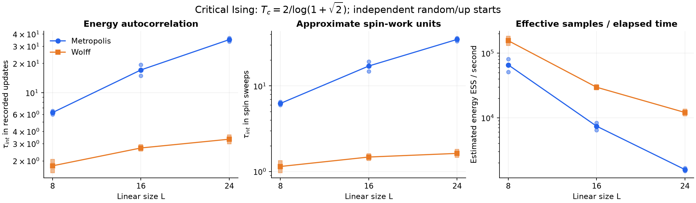
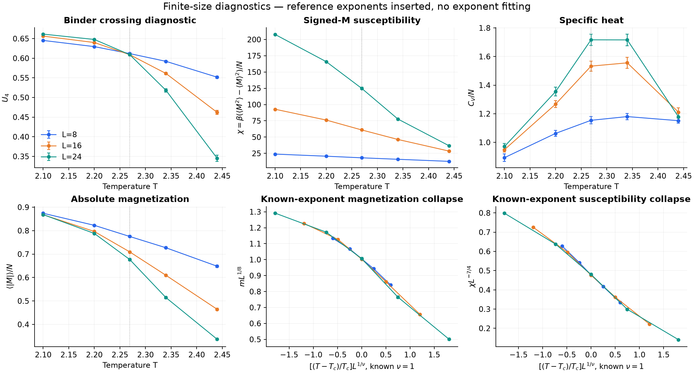

# Reproducible Ising experiments / 可复现 Ising 数值实验

这个目录把算法工具包变成可以检查的数值实验：同一临界点的算法比较，以及跨温度、跨尺寸的热力学和有限尺寸诊断。这里展示的是**实际执行的有限规模复现实验**，不宣称获得新的临界指数或已经达到生产计算精度。

新的 [foundation 实验](foundation/README.md) 使用可恢复运行器、三种更新算法和
Julia/CairoMakie 分析绘图，增加独立精确枚举对照及更长的链。下文保留前一轮
42 条链的结果；其复现声明对应随数据记录的源码版本，而非之后的算法重构。

## 直接查看

- [算法比较](results/demo/figures/algorithm_comparison.png)：相关时间、近似自旋工作单位、单位实际时间的有效样本数。
- [原始链与自相关](results/demo/figures/chain_diagnostics.png)：最大尺寸的两种初态与两种算法。
- [热力学与标度图](results/demo/figures/finite_size_diagnostics.png)：Binder 比、磁化率、比热、磁化及已知指数的缩放检验。
- [每条链的结果](results/demo/summary.csv)、[配置](results/demo/config.toml)、[环境与源码哈希](results/demo/metadata.toml)、[诊断警告](results/demo/diagnostics.json)、[压缩原始轨迹](results/demo/traces)。





## 实验问题与实际结果

模型为周期边界的二维方格零场铁磁 Ising，`J=kB=1`，`N=L²`；临界点使用精确值 `Tc=2/log(1+sqrt(2))`。

1. **簇更新是否降低临界附近的相关性？** `L=8,16,24`，分别使用 Metropolis 与 Wolff，每种条件运行一条随机初态链和一条全向上初态链，各自使用不同随机种子。两条链的能量相关时间均值如下。

   | L | Metropolis：sweeps | Wolff：cluster updates | Wolff：近似 spin sweeps |
   |---|---:|---:|---:|
   | 8 | 6.25 | 1.78 | 1.14 |
   | 16 | 17.09 | 2.71 | 1.48 |
   | 24 | 34.95 | 3.33 | 1.63 |

   这里两个算法的“一步”不同，不能把第二、三列直接当成速度比。第三种单位将 Wolff 的相关时间乘以平均簇大小/N，Metropolis 则按每 N 次尝试一个 sweep；它仍不是 CPU 成本。图中另外给出 `ESS / production_seconds`，反映本机这份实现的有限规模结果。短计时、内存分配、测量开销、运行顺序和硬件状态都会影响吞吐量，因此不把数值当成跨硬件性能承诺，也不由三个尺寸拟合动力学指数 z。

2. **不同尺寸的 Binder 比是否在已知临界点附近接近？** 使用 Wolff，在 `T=2.10,2.20,Tc,2.34,2.44` 扫描上述三个尺寸，每个参数点仍使用两条独立链。`Tc` 处得到 `U4=0.6118±0.0020 (L=8)`、`0.6090±0.0019 (L=16)`、`0.6091±0.0028 (L=24)`。这些是有限尺寸结果和诊断性误差，支持进一步加密临界温区，不足以给出独立的精确 Tc 估计。

3. **已知标度形式是否与数据相容？** 图中明确代入二维 Ising 的 `ν=1, β=1/8, γ=7/4` 和已知 Tc，绘制磁化与磁化率缩放图。这是在检验实现和缩放操作；没有拟合这些指数，也没有用视觉上的重合证明普适性。

共运行 **42 条链，336,000 个生产测量**；每条链先热化 2,000 次相应算法更新，再记录 8,000 次更新。运行使用 Julia 1.12.6；准确参数、种子、源码 SHA256、平台及绘图版本见结果元数据。

本次还用相同 Julia 版本和种子完整重跑了 42 条链，解压后的所有原始轨迹逐字节一致；这验证了当前环境下的随机流复现性，运行时间自然不会逐位一致。

## 复现

从仓库根目录执行，Julia 模拟只需标准库和本项目：

```bash
# 输出目录必须为空，防止误覆盖已有结果。
julia --project=. experiments/run_ising.jl experiments/configs/demo.toml experiments/results/my-demo

# Python 3.11+ 用于读 TOML、检查数据和绘图。
python -m pip install -r experiments/requirements.txt
python experiments/plot_ising.py experiments/results/my-demo --compress
python experiments/verify_results.py experiments/results/my-demo
```

只重新生成已提供数据的图、不再模拟：

```bash
python experiments/plot_ising.py experiments/results/demo
python experiments/verify_results.py experiments/results/demo --allow-source-drift
```

`--compress` 使用 gzip 无损压缩原始 CSV，并移除对应未压缩副本；重复绘图可直接读 `.csv.gz`。已提供 demo 全部结果约 3.5 MB。`verify_results.py` 检查全部 336,000 个记录的边界、能量格点、磁化奇偶性、种子唯一性、每条链六个原始矩估计量与源码哈希；这些检查不证明达到平衡。Julia 不保证跨版本 RNG 流逐位一致，应同时保留元数据与原始数据。

默认校验要求源码哈希完全一致。仓库内这组旧 demo 使用重构前的源码，检查时显式加
`--allow-source-drift`：仍执行全部数据与观测量检查，并报告源码差异，不改写历史元数据，
也不声称当前代码能逐位重现旧轨迹。新生成的数据应使用默认严格校验。

较长的 [research.toml](configs/research.toml) 提供 `L≤64`、8 条链、200,000 个生产样本的起点，**尚未执行**。它并不自动满足收敛要求，尤其需重新检查较大 L 的 Metropolis 链。不要直接把该配置描述成已经完成的研究。

## 统计约定与已知不足

- 原始轨迹保存总能量 E、带符号总磁化 M 和本次翻转的自旋数。每次测量间隔为一个 Metropolis sweep 或一个 Wolff cluster update；连续轨迹没有被打乱。
- `summary.csv` 使用 `ising_observables` 的 `raw` 原始矩估计量，误差来自保持同一 E/M 记录配对的删块 jackknife。主块长为 200，同时保留块长 800 的误差，供检查块长依赖。比热为 `β² Var(E)/N`；磁化率为 `β Var(M)/N`；同时保存用 `|M|` 扣除的有限系统代理量，两者明确区分。Binder 为 `1-<M⁴>/(3<M²>²)`。
- 绘图的跨链均值误差取“两种块长中较大的链内误差独立合成”和“链均值的链间标准误差”中的较大者。只有两条链，这个规则只是诊断，不能保证置信区间覆盖率。它不包括有限尺寸、热化和自相关窗口的系统误差。
- 相关时间使用包中的首个非正相关处截断方法；`ESS=n/(2τ)`。不能由这个估计证明平衡，负相关尾和噪声会影响结果。Wolff 的带符号磁化可能有强负相关，故此处只报告 E 与 `|M|` 的 τ，没有将该方法直接套到 signed M 上。
- **有四条 Metropolis 链（L=16、24）触发“200 样本块长不足 10τ”的提示。** 提示保留在结果中。较大块只有 10 块，误差本身也不稳定；需要更长的链、更多初态以及系统的块长/丢弃长度扫描。临界温区的 Wolff 扫描未触发这一启发式提示，也不能因此宣称收敛。
- 热化阶段没有保留在轨迹中，因此当前图不能重做更短 burn 的比较。继续研究时应增加多个预设 burn 长度、更多独立链、生产阶段前后半段比较、靠近交叉点的密集温度，以及有修正项的最小尺寸扫描。对 Cv、Binder 等非线性量还应检查其相关性与误差稳定性。
- 所有曲线连线只用于引导视觉。没有独立测定临界点、指数或普适振幅，没有隐含精度优于上述诊断的主张。

这些约定和原始数据适合在申请材料中讨论：为什么簇算法有效，如何发现临界慢化，为什么相关样本的误差不能直接使用 `std/sqrt(n)`，以及下一轮计算应怎样设计。
