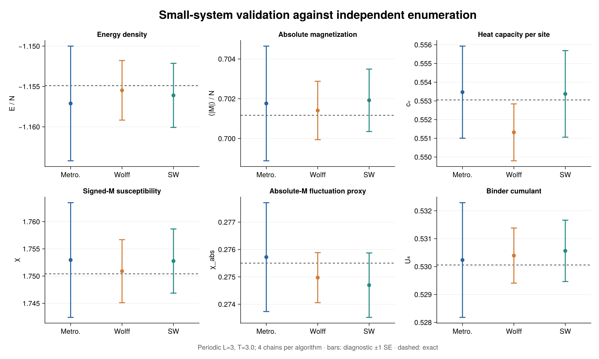
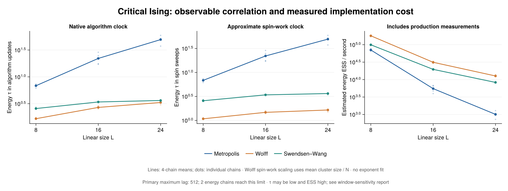
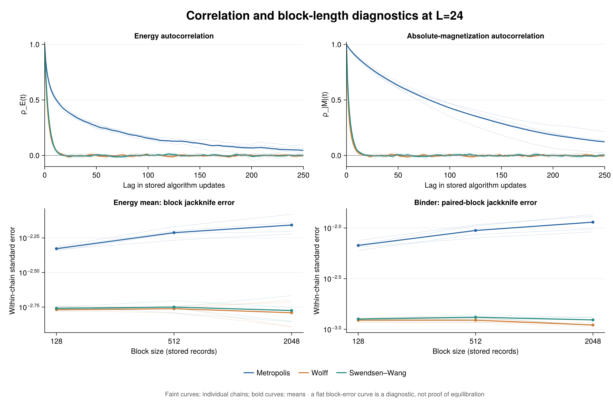

# Executed foundation study

48 independent-seed chains, 1572864 measurements; Julia 1.12.6.

Each chain uses 8192 warmup updates, 32768 retained measurements and stride 1. Block sizes: 128, 512, 2048; maximum ACF lag: 512. Full traces, configuration, source hashes and exact-reference values are saved alongside this report.

## Independent finite-system reference

Exact enumeration covers all 512 states of the periodic L=3 Ising model at T=3.0.

| Algorithm | Energy / N | Absolute magnetization / N | Binder U4 |
|---|---:|---:|---:|
| metropolis | -1.157104 ± 0.007103 | 0.701762 ± 0.002884 | 0.530235 ± 0.002055 |
| wolff | -1.155477 ± 0.003689 | 0.701409 ± 0.001468 | 0.530395 ± 0.000987 |
| swendsen_wang | -1.156104 ± 0.003971 | 0.701921 ± 0.001570 | 0.530564 ± 0.001100 |
| Exact | -1.154886 | 0.701167 | 0.530058 |

Across the six observables and three algorithms, the largest discrepancy is 1.14 diagnostic standard errors. This is a validation comparison, not a simultaneous coverage guarantee.

## Critical algorithm comparison

| L | Algorithm | Mean energy tau (native updates) | Mean energy ESS / second |
|---:|---|---:|---:|
| 8 | metropolis | 6.832 | 70405.1 |
| 8 | wolff | 1.662 | 179690.2 |
| 8 | swendsen_wang | 2.570 | 99208.9 |
| 16 | metropolis | 22.044 | 5506.2 |
| 16 | wolff | 2.696 | 31288.1 |
| 16 | swendsen_wang | 3.406 | 19610.4 |
| 24 | metropolis | 49.422 | 1007.8 |
| 24 | wolff | 3.334 | 12692.2 |
| 24 | swendsen_wang | 3.631 | 8296.5 |

Native updates are Metropolis sweeps, Wolff cluster updates, or SW sweeps. They do not have equal cost. Production timing includes measurements, excludes compile/warmup/storage, and is a limited single-machine implementation benchmark.

There are 8 short-block warnings, 0 large-block warnings and 2 positive-window truncation flags. No flag is an equilibration certificate. Only 4 chains per condition were used; error bars are diagnostic. No critical temperature or exponent was fitted.

Block and window flags use energy and absolute M only. They do not certify the errors of signed-M susceptibility or nonlinear observables: slow magnetization-sector transitions can remain hidden. Signed-M means, sign fractions and its L=24 ACF are saved for further inspection.

The saved partial run resumed to exactly the same measurements, counters and final spins as uninterrupted execution in this environment. See manifest.toml.

