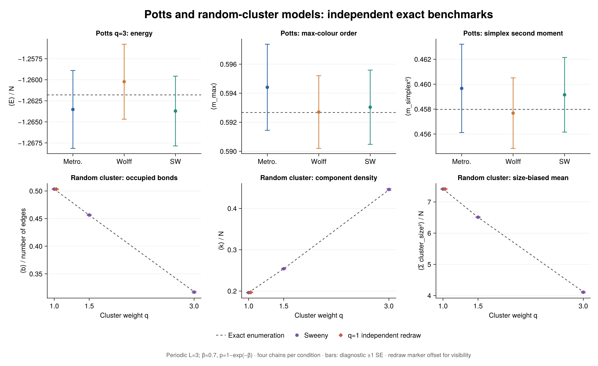
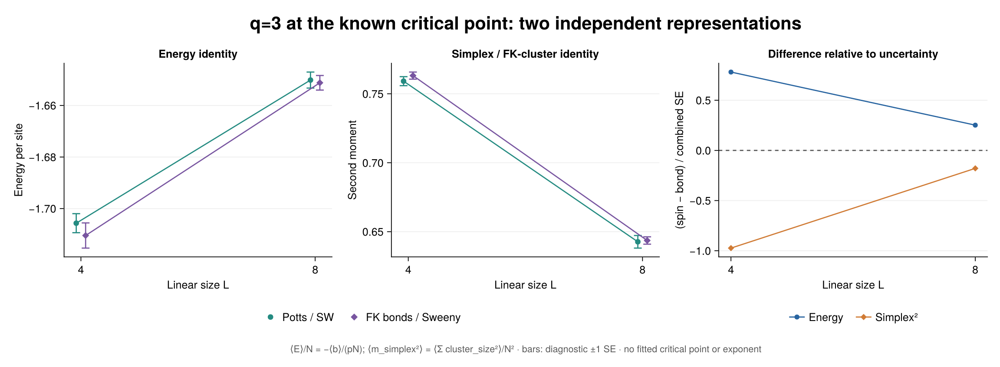
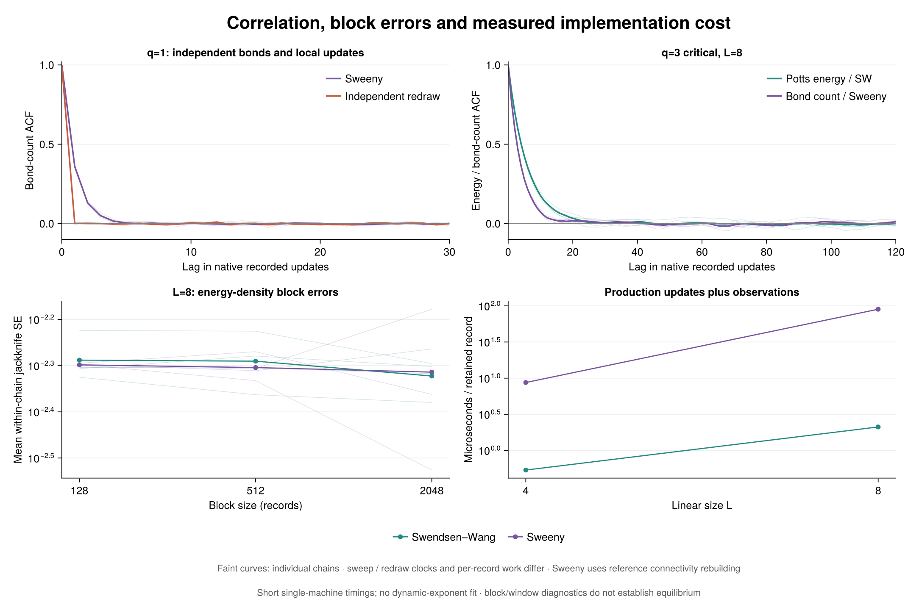

# Executed Potts and random-cluster study

44 independent-seed chains, 720896 recorded measurements; Julia 1.12.6. Each chain has 4096 warmup updates and 16384 production records, stride 1. Raw data, model-specific units, source hashes and restart evidence are saved.

## Exact finite-system validation

Periodic L=3 Potts q=3, beta=0.7, is enumerated independently over all q^(L²) spin assignments. The same graph's random-cluster measure is enumerated over all 2^(2L²) bond subsets at q=1.0, 1.5, 3.0. The q=1 case also has independent Bernoulli redraws.

| Family | q | Algorithm | Largest absolute discrepancy / diagnostic SE |
|---|---:|---|---:|
| Potts | 3.0 | metropolis | 0.587 |
| Potts | 3.0 | wolff | 1.086 |
| Potts | 3.0 | swendsen_wang | 2.151 |
| RandomCluster | 1.0 | sweeny | 0.610 |
| RandomCluster | 1.0 | independent | 0.901 |
| RandomCluster | 1.5 | sweeny | 0.384 |
| RandomCluster | 3.0 | sweeny | 0.608 |

These many correlated comparisons are validation diagnostics, not a simultaneous confidence-coverage test. Full estimates and references are in analysis/aggregate.csv. Potts max-colour fluctuations are not relabelled as a signed magnetic susceptibility.

## Cross-representation checks at the known q=3 critical point

Spin SW and bond Sweeny run independently on identical periodic graphs at beta=log(1+sqrt(q)) and p=sqrt(q)/(1+sqrt(q)). The checked identities are <E>/N=-<b>/(pN) and <simplex_squared>=<sum(cluster_size²)>/N².

| L | Quantity | Spin estimate ± SE | Bond-derived estimate ± SE | Difference / combined SE |
|---:|---|---:|---:|---:|
| 4 | energy_density | -1.705677 ± 0.003688 | -1.710459 ± 0.004886 | 0.781 |
| 4 | simplex_second_moment | 0.759151 ± 0.003260 | 0.763195 ± 0.002573 | -0.974 |
| 8 | energy_density | -1.650132 ± 0.003107 | -1.651191 ± 0.002829 | 0.252 |
| 8 | simplex_second_moment | 0.642691 ± 0.004565 | 0.643636 ± 0.002666 | -0.179 |

At L=3 the two independent enumerators satisfy both identities to absolute error below 1e-10. The spin mapping requires integer q; q=1.5 is sampled and validated only in the random-cluster representation.

## Correlation, cost and limitations

| L | Family / algorithm | Mean primary tau (native updates) | Mean primary ESS / second |
|---:|---|---:|---:|
| 4 | Potts / swendsen_wang | 3.918 | 238225.3 |
| 4 | RandomCluster / sweeny | 3.286 | 17789.3 |
| 8 | Potts / swendsen_wang | 6.157 | 38988.4 |
| 8 | RandomCluster / sweeny | 4.118 | 1361.2 |

Primary traces are Potts energy and RC occupied-bond count. They estimate related equilibrium means but have different transition processes and conditional noise; these ESS values are observable-specific. One spin sweep, one Wolff cluster, one Sweeny m-attempt sweep and one independent full redraw are different clocks. Production timings include measurement and are short, sequential, single-machine implementation timings. They exclude compilation, warmup, storage and analysis.

The reference Sweeny kernel rebuilds connectivity for edge proposals; scratch reuse does not turn its O(m²)-per-sweep method into a dynamic-connectivity algorithm. No critical point, dynamic exponent, or phase-transition order is inferred from these sizes.

Sweeny observations are one full sweep apart. This study cannot resolve sub-sweep relaxation or test published critical speeding-up; tau near the positive-window estimator's 0.5-record floor does not rule out faster modes.

There are 0 small-block warnings, 0 largest-block warnings and 0 ACF-window flags. These compare selected linear-observable correlations with block/window choices; they neither establish equilibrium nor certify errors of nonlinear quantities. Block sizes 128, 512, 2048 and all per-chain diagnostics remain available.

5 model/algorithm restart audits reproduce paired observations, final physical configurations, update/work counters and future random draws exactly in this environment.

