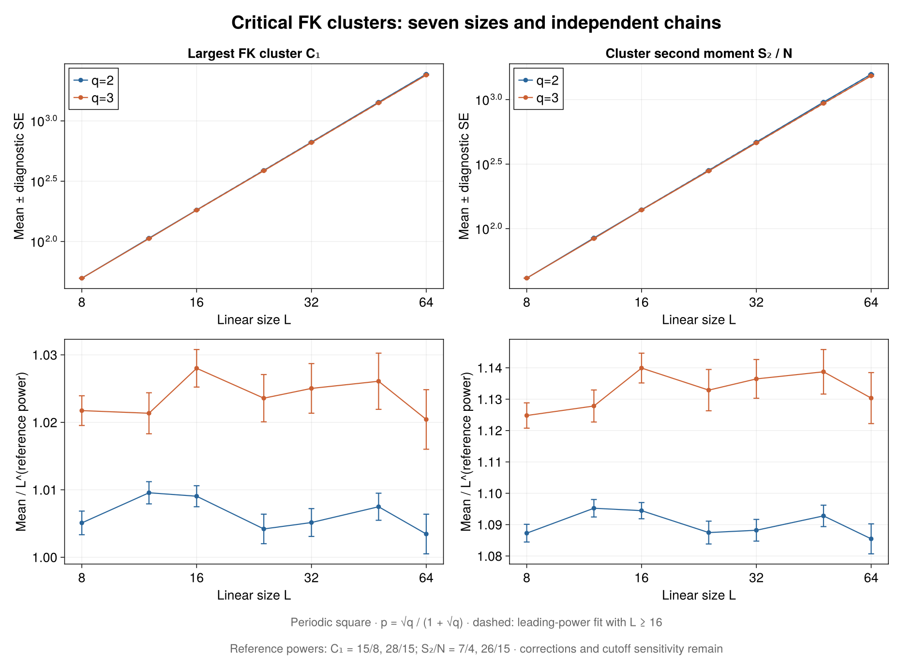
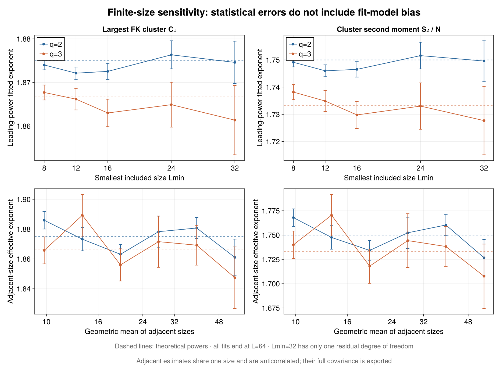
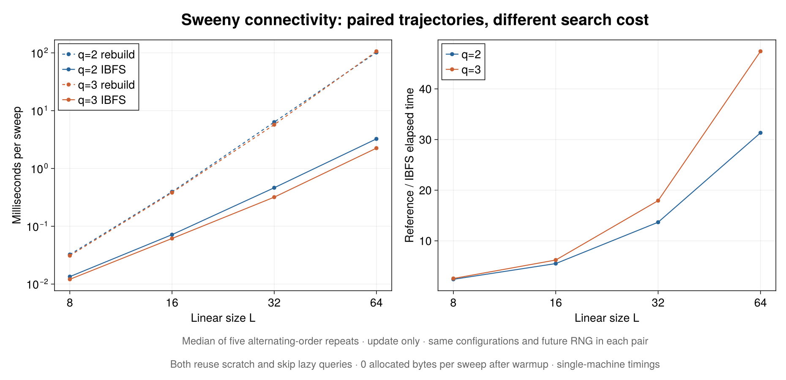
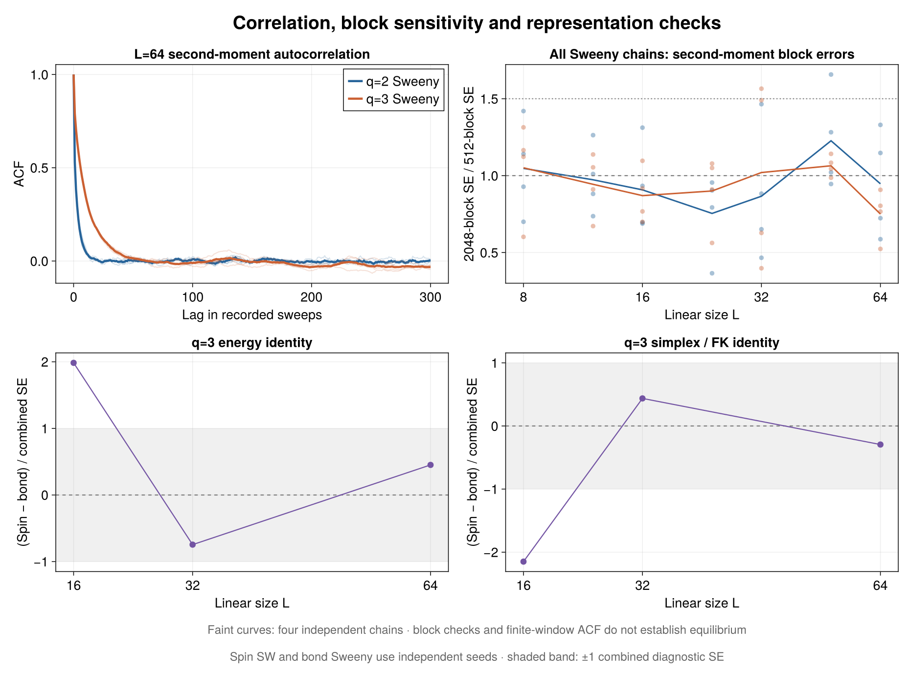

# Critical cluster scaling: executed results

68 independent-seed chains and 1114112 retained measurements. Periodic square lattices, q=2 and 3, L=8, 12, 16, 24, 32, 48, 64. Each chain: 8192 warmup sweeps and 16384 production records. Sampling at the known critical p=sqrt(q)/(1+sqrt(q)); no critical point is estimated.

## Leading-power fits and size sensitivity

C1 is the largest FK component size; S2_over_N is the sum of squared sizes of **all** components divided by N. The reference powers are respectively 15/8 and 7/4 (q=2), 28/15 and 26/15 (q=3). See [definitions and sources](../../README.md).

| q | Observable | Lmin | Fitted power ± statistical SE | Reference | chi2 / dof |
|---:|---|---:|---:|---:|---:|
| 2 | C1 | 8 | 1.874009 ± 0.001116 | 1.875000 | 8.50 / 5 |
| 2 | C1 | 16 | 1.872542 ± 0.001845 | 1.875000 | 3.74 / 3 |
| 2 | C1 | 32 | 1.874601 ± 0.004871 | 1.875000 | 1.44 / 1 |
| 2 | S2_over_N | 8 | 1.749140 ± 0.001703 | 1.750000 | 8.78 / 5 |
| 2 | S2_over_N | 16 | 1.746531 ± 0.002827 | 1.750000 | 3.48 / 3 |
| 2 | S2_over_N | 32 | 1.749594 ± 0.007451 | 1.750000 | 1.78 / 1 |
| 3 | C1 | 8 | 1.867701 ± 0.001722 | 1.866667 | 4.45 / 5 |
| 3 | C1 | 16 | 1.863002 ± 0.003158 | 1.866667 | 1.10 / 3 |
| 3 | C1 | 32 | 1.861353 ± 0.007947 | 1.866667 | 0.54 / 1 |
| 3 | S2_over_N | 8 | 1.738183 ± 0.002784 | 1.733333 | 5.09 / 5 |
| 3 | S2_over_N | 16 | 1.729790 ± 0.004998 | 1.733333 | 0.98 / 3 |
| 3 | S2_over_N | 32 | 1.727703 ± 0.012574 | 1.733333 | 0.43 / 1 |

Fits use log-space weighted least squares with delta-method relative errors. Size errors are the larger of the combined within-chain block SE and between-chain SE (four chains). They are estimated, so chi2 is diagnostic. Adjacent effective exponents share data: their full covariance is saved. All size cutoffs, 400 stratified block-bootstrap quantiles and fixed-power correction sensitivities (omega=0.8,1.2,4/3,2) are saved in analysis/. No correction exponent is inferred.

For the illustrative L>=16 range, the four fitted powers are within 1.33 diagnostic standard errors of their reference values. Raising Lmin widens errors because fewer sizes remain; the q=3 second-moment slope also shifts visibly between Lmin=8 and 16. A near-straight log-log curve alone therefore does not establish asymptotic scaling.

The fit errors and bootstrap intervals omit finite-size model bias and possible residual nonstationarity. Compare cutoff dependence, scaled amplitudes and residuals before interpreting a fitted slope as an asymptotic exponent. This study is a reproducible scaling demonstration, not a precision determination.

## Independent Potts / FK checks

| L | Observable | Spin ± SE | Bond ± SE | Difference / combined SE |
|---:|---|---:|---:|---:|
| 16 | energy_density | -1.617384 ± 0.002063 | -1.622666 ± 0.001683 | 1.984 |
| 16 | S2_over_N | 137.001226 ± 0.909575 | 139.320134 ± 0.580095 | -2.150 |
| 32 | energy_density | -1.602920 ± 0.001396 | -1.601551 ± 0.001193 | -0.745 |
| 32 | S2_over_N | 463.739089 ± 3.578805 | 461.831384 ± 2.509381 | 0.436 |
| 64 | energy_density | -1.589890 ± 0.001040 | -1.590509 ± 0.000891 | 0.452 |
| 64 | S2_over_N | 1522.002630 ± 14.214632 | 1527.291526 ± 10.979497 | -0.294 |

Potts SW and Sweeny are independently seeded. Energy uses -<b>/(pN); the second moment uses N*<simplex_squared>=<S2>/N. Maximum-colour order is never identified with the largest FK cluster.

## Statistical diagnostics and reproducibility

Primary blocks: 512 sweeps; alternatives: 128, 512, 2048. Largest estimated tau: 20.54 sweeps. Flags: block/tau<10: 0; largest-block SE/primary SE>1.5: 7; ACF window exhausted: 0; first-half/second-half discrepancy >3 SE: 0. The large-block flags occur in 3 distinct chains. These are multiple, correlated diagnostics, not tests that prove equilibrium. Raw trajectories and every per-chain diagnostic are retained. `discard_power_fits.csv` repeats the L>=16 fits after discarding 0, one-quarter or one-half of production; these overlapping fits are correlated and do not replace longer burn tests.

Reweighting the L>=16 fits with each block length gives the following sensitivity check. Means are unchanged; weights and error estimates change. At block length 2048 only eight blocks remain per chain, so those error estimates are themselves noisy. No flag is silently removed.

| q | Observable | Block length | Power ± statistical SE |
|---:|---|---:|---:|
| 2 | C1 | 128 | 1.872708 ± 0.001908 |
| 2 | C1 | 512 | 1.872542 ± 0.001845 |
| 2 | C1 | 2048 | 1.872223 ± 0.001933 |
| 2 | S2_over_N | 128 | 1.746772 ± 0.002937 |
| 2 | S2_over_N | 512 | 1.746531 ± 0.002827 |
| 2 | S2_over_N | 2048 | 1.745829 ± 0.002934 |
| 3 | C1 | 128 | 1.863107 ± 0.003169 |
| 3 | C1 | 512 | 1.863002 ± 0.003158 |
| 3 | C1 | 2048 | 1.862747 ± 0.003019 |
| 3 | S2_over_N | 128 | 1.729914 ± 0.005012 |
| 3 | S2_over_N | 512 | 1.729790 ± 0.004998 |
| 3 | S2_over_N | 2048 | 1.729425 ± 0.004827 |

The largest change of fitted slope across these block choices is 0.25 times the primary fit SE. This limited block sensitivity does not explain away the individual-chain flags; additional long independent runs would make the uncertainty estimates more stable.

Three restart audits (including L=64 bond and spin runs) reproduce observations, final configurations, work/clock counters and future RNG. Metadata contains seeds, units, Julia version and source/input hashes. Reanalysis never resamples physical states. IBFS improves connectivity searches but is not a fully dynamic connectivity data structure; no dynamic critical exponent or sub-sweep acceleration is inferred.

